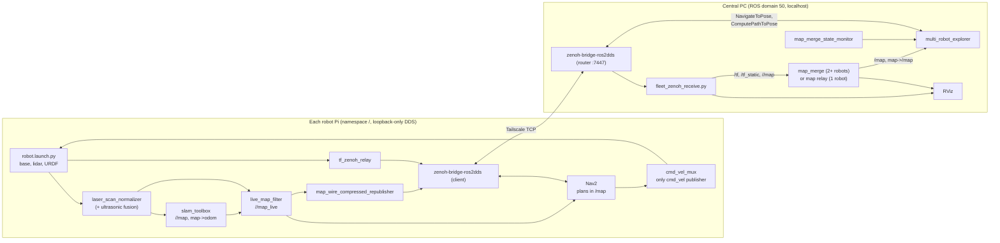

# Fleet architecture

What runs where, and every piece of data that crosses between a robot and the central PC.

## Where software runs

On the robot, `cmd_vel_mux` is the only node that drives the base: Nav2's controller and behaviors, the stuck detector's reflexes and the stereo stop gate all go through it (turtlebot3 `docs/navigation.md`, "Motion commands").

A robot never receives TF or maps from the central PC. It only receives action goals, so it keeps its own consistent view and a dropped link stops new goals without confusing Nav2.

## Data on the link

Allowlists: `config/zenoh/central_router.json5.tmpl` here and `config/zenoh/robot_client.json5.tmpl` in the turtlebot3 workspace. Keep them in step.

| Robot sends | Rate cap | Central turns it into |
| --- | --- | --- |
| `/<robot>/tf_zenoh` (changed edges only, best effort) | 10 Hz | `/tf` |
| `/<robot>/tf_static_zenoh` | 1 Hz | `/tf_static` (one latched message for the fleet) |
| `/<robot>/map_wire_z` (zlib-compressed `map_live`) | 1 Hz | `/<robot>/map` |
| `/<robot>/nav2_collision_ahead`, `nav2_retrace_active` | — | read by the explorer (robot nodes are off by default) |
| `/<robot>/plan`, `scan_normalized`, `local_costmap/costmap` | 2/2/1 Hz | RViz only; sent while someone subscribes |

Nav2 actions `/<robot>/navigate_to_pose` and `/<robot>/compute_path_to_pose` are bridged both ways.

Robot frames already carry the robot prefix (`inky/odom`, `inky/base_footprint`, `inky/map`), so every robot's TF lands in one `/tf` tree without renaming. The world frame `map` belongs to the central PC: `map_merge` publishes `map -> <robot>/map`, or with one robot `single_robot_world_tf_bridge.py` publishes it as identity.

### Why TF goes through `tf_zenoh_relay`

The Zenoh bridge subscribes with the publisher's QoS. A reliable reader on `/<robot>/tf` back-pressures slam_toolbox, `map -> odom` goes stale, and Nav2 reports false goal success. The helper (C++ `tf_zenoh_relay` in the robot's `turtlebot3_navigation2`; `scripts/comms/tf_zenoh_publish.py` is the fallback) reads best-effort and republishes on `*_zenoh` topics instead.

### DDS settings on the central PC

The bridge injects topics through Cyclone's built-in localhost profile (`ROS_LOCALHOST_ONLY=1`, no `CYCLONEDDS_URI`). Every central process uses the same profile via `fleet_use_zenoh_dds` in `scripts/env/fleet_common.bash`. RViz is the exception: it uses `config/cyclonedds/central_localhost.xml` to get past Cyclone's 10-participant default cap.

## Changing surroundings

slam_toolbox keeps every scan it ever used, so an obstacle that has gone (a door since opened, a chair moved, a person who stood still) stays in `/<robot>/map` until hundreds of beams have passed through it. `live_map_filter.py` on the robot republishes the map as `/<robot>/map_live` without SLAM obstacles the LiDAR has seen through for several scans in a row and not hit since; one hit brings a cell back. The global costmap's static layer and the map sent to this PC both use `map_live`. Beams that only graze a wall do not count, and cells next to unknown space are never cleared, so walls do not grow holes that turn into frontiers. New obstacles and moving people reach Nav2 through the costmaps' obstacle layers at once and the SLAM map after a few hits.

On this side, when an obstacle disappears from a map (`map_opening_*`), every robot's blacklist and "unreachable" state are cleared, so frontiers behind a door that has opened are tried again, and exploration resumes even if the robots had already gone home.

## Exploration loop

1. Frontiers: free cells next to unknown cells on the merged `/map` (or a robot's own map early on; `mode: auto` switches when `map_merge/merge_state` reports `MERGED` stably).
2. Assignment: each idle robot gets the unclaimed frontier with the best size-versus-distance score; robots are kept apart. Distance is travel distance around walls (Dijkstra on the map, `use_geodesic_distance`), size counts only up to `frontier_gain_cap_m`, and turning back costs a little (`heading_penalty_m`), so a robot finishes the room it is in instead of crossing the map for a large frontier behind a wall.
3. Precheck: `compute_path_to_pose` on the robot. Goals with no plan are blacklisted and the next frontier is tried, unless plans to several different goals fail with the robot in place (`boxed_in_*`): then the robot is boxed in, not the frontiers, so nothing is blacklisted and the explorer waits while the robot's stuck_detector clears its costmap and narrows its radius. After `boxed_in_max_waits` such waits at one spot the goals count as unreachable after all (every frontier left may be behind a closed door).
4. Dispatch: the goal is transformed into `<robot>/map` and sent as `NavigateToPose`. Nav2 on the robot plans and drives.
5. Watchdogs: stalls, aborts and repeated near-identical goals are cancelled and blacklisted. An idle robot whose frontiers are all blacklisted gets its blacklist cleared and retries (`blacklist_reset_*`); when they still fail after the last reset, they count as unreachable (for example seen through glass). So do frontiers that only ever fail the goal safety gate (too close to obstacles) for `blacklist_reset_idle_sec`. When no frontiers remain, or only unreachable ones for every robot, robots return home: the origin of their own SLAM map (where they stood when SLAM started), looked up in the world frame each time because the merge can move it. A blocked return is retried every `return_to_start_retry_sec`.

Parameters: `src/m-explore-ros2/explore/config/multi_robot_explorer.yaml`, `src/m-explore-ros2/map_merge/config/multirobot_params_unknown_poses.yaml`.
