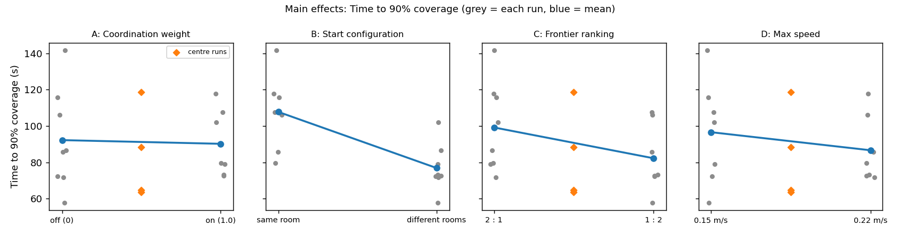
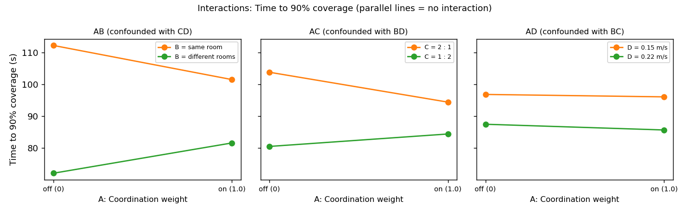
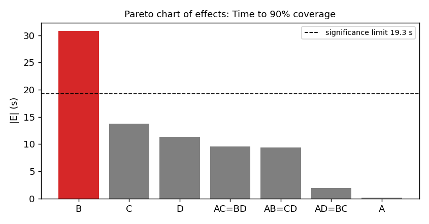
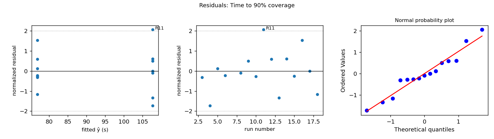
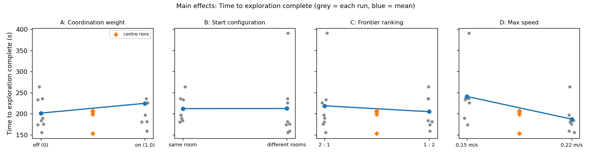
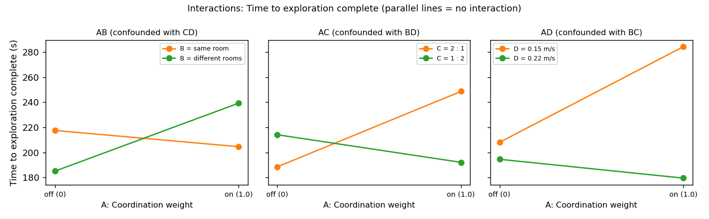
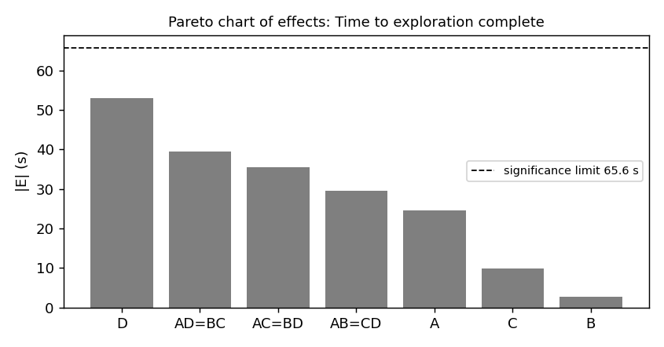
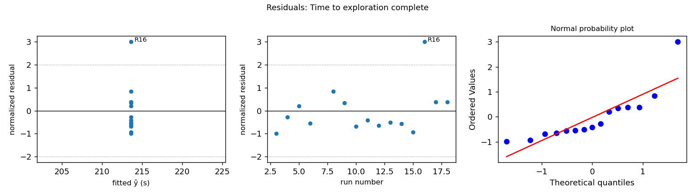

# ENTC 641 experiment: analysis

15 factorial and 4 centre-point runs (excluded: R02). Design 2^(4-1) with D = ABC, two replicates; AB, AC and AD are confounded with CD, BD and BC.

## 1. Input data

| Run | Session | Condition | A | B | C | D | Time to 90% coverage | Time to exploration complete |
| --- | --- | --- | --- | --- | --- | --- | --- | --- |
| R09 | 1 | 1 | -1 | -1 | -1 | -1 | 115.8 | 233.5 |
| R11 | 2 | 1 | -1 | -1 | -1 | -1 | 141.5 | 189.5 |
| R04 | 1 | 2 | +1 | -1 | -1 | +1 | 79.5 | 197.2 |
| R14 | 2 | 2 | +1 | -1 | -1 | +1 | 117.6 | 180.7 |
| R03 | 1 | 3 | -1 | +1 | -1 | +1 | 71.7 | 155.5 |
| R12 | 2 | 3 | -1 | +1 | -1 | +1 | 86.5 | 175.7 |
| R05 | 1 | 4 | +1 | +1 | -1 | -1 | 78.9 | 226.0 |
| R16 | 2 | 4 | +1 | +1 | -1 | -1 | 101.9 | 390.7 |
| R08 | 1 | 5 | -1 | -1 | +1 | +1 | 106.2 | 263.5 |
| R13 | 2 | 5 | -1 | -1 | +1 | +1 | 85.7 | 183.7 |
| R17 | 2 | 6 | +1 | -1 | +1 | -1 | 107.6 | 236.0 |
| R10 | 1 | 7 | -1 | +1 | +1 | -1 | 72.4 | 173.7 |
| R18 | 2 | 7 | -1 | +1 | +1 | -1 | 57.9 | 235.7 |
| R06 | 1 | 8 | +1 | +1 | +1 | +1 | 73.2 | 181.5 |
| R15 | 2 | 8 | +1 | +1 | +1 | +1 | 72.6 | 159.0 |
| R01 | 1 | centre | +0 | -1 | +0 | +0 | 88.2 | 207.0 |
| R07 | 1 | centre | +0 | +1 | +0 | +0 | 64.8 | 204.7 |
| R19 | 2 | centre | +0 | +1 | +0 | +0 | 63.5 | 198.2 |
| R20 | 2 | centre | +0 | -1 | +0 | +0 | 118.5 | 153.5 |

## Time to 90% coverage (s)

### Plots

### Calculation matrix and effects

| Test | A | B | C | D | AB=CD | AC=BD | AD=BC | y (replicates) | ȳ | S² |
| --- | --- | --- | --- | --- | --- | --- | --- | --- | --- | --- |
| 1 | -1 | -1 | -1 | -1 | +1 | +1 | +1 | 115.8, 141.5 | 128.7 | 330.2 |
| 2 | -1 | -1 | +1 | +1 | +1 | -1 | -1 | 106.2, 85.7 | 96.0 | 210.1 |
| 3 | -1 | +1 | -1 | +1 | -1 | +1 | -1 | 71.7, 86.5 | 79.1 | 109.5 |
| 4 | -1 | +1 | +1 | -1 | -1 | -1 | +1 | 72.4, 57.9 | 65.2 | 105.1 |
| 5 | +1 | -1 | -1 | +1 | -1 | -1 | +1 | 79.5, 117.6 | 98.5 | 725.8 |
| 6 | +1 | -1 | +1 | -1 | -1 | +1 | -1 | 107.6 | 107.6 |  |
| 7 | +1 | +1 | -1 | -1 | +1 | -1 | -1 | 78.9, 101.9 | 90.4 | 264.5 |
| 8 | +1 | +1 | +1 | +1 | +1 | +1 | +1 | 73.2, 72.6 | 72.9 | 0.2 |

| Effect | E (s) | t | Significant |
| --- | --- | --- | --- |
| A | +0.1 | +0.02 |  |
| B | -30.8 | -3.78 | yes |
| C | -13.8 | -1.69 |  |
| D | -11.3 | -1.39 |  |
| AB=CD | +9.4 | +1.15 |  |
| AC=BD | +9.5 | +1.17 |  |
| AD=BC | -1.9 | -0.24 |  |

Average 92.3 s. Pooled variance Sp² = 249.4 (7 dof), S²_effect = 4·Sp²/N = 66.5 (N = 15), S_effect = 8.2. Two-tailed t critical at α = 0.05: 2.365, so an effect must exceed 19.3 s in size.

### Model and residuals

ŷ = 92.3 -15.4·XB   (s, coded X = ±1)

Residual standard deviation 16.4 s. Normalized residuals beyond ±2: R11 (+2.1).

### Centre points

Centre runs (A, C, D = 0) against the model at the same setting. A gap well beyond the residual SD (16.4 s) would mean the response curves between the levels and a straight-line model is not enough.

| Run | B | Observed (s) | Model | Difference |
| --- | --- | --- | --- | --- |
| R01 | same room | 88.2 | 107.7 | -19.5 |
| R07 | different rooms | 64.8 | 76.9 | -12.1 |
| R19 | different rooms | 63.5 | 76.9 | -13.4 |
| R20 | same room | 118.5 | 107.7 | +10.8 |

## Time to exploration complete (s)

### Plots

### Calculation matrix and effects

| Test | A | B | C | D | AB=CD | AC=BD | AD=BC | y (replicates) | ȳ | S² |
| --- | --- | --- | --- | --- | --- | --- | --- | --- | --- | --- |
| 1 | -1 | -1 | -1 | -1 | +1 | +1 | +1 | 233.5, 189.5 | 211.5 | 968.0 |
| 2 | -1 | -1 | +1 | +1 | +1 | -1 | -1 | 263.5, 183.7 | 223.6 | 3184.0 |
| 3 | -1 | +1 | -1 | +1 | -1 | +1 | -1 | 155.5, 175.7 | 165.6 | 204.0 |
| 4 | -1 | +1 | +1 | -1 | -1 | -1 | +1 | 173.7, 235.7 | 204.7 | 1922.0 |
| 5 | +1 | -1 | -1 | +1 | -1 | -1 | +1 | 197.2, 180.7 | 188.9 | 136.1 |
| 6 | +1 | -1 | +1 | -1 | -1 | +1 | -1 | 236.0 | 236.0 |  |
| 7 | +1 | +1 | -1 | -1 | +1 | -1 | -1 | 226.0, 390.7 | 308.4 | 13563.0 |
| 8 | +1 | +1 | +1 | +1 | +1 | +1 | +1 | 181.5, 159.0 | 170.2 | 253.1 |

| Effect | E (s) | t | Significant |
| --- | --- | --- | --- |
| A | +24.5 | +0.88 |  |
| B | -2.8 | -0.10 |  |
| C | -10.0 | -0.36 |  |
| D | -53.0 | -1.91 |  |
| AB=CD | +29.6 | +1.07 |  |
| AC=BD | -35.6 | -1.28 |  |
| AD=BC | -39.5 | -1.42 |  |

Average 213.6 s. Pooled variance Sp² = 2890.0 (7 dof), S²_effect = 4·Sp²/N = 770.7 (N = 15), S_effect = 27.8. Two-tailed t critical at α = 0.05: 2.365, so an effect must exceed 65.6 s in size.

### Model and residuals

ŷ = 213.6    (s, coded X = ±1): no significant effect, so the model is the average

Residual standard deviation 58.9 s. Normalized residuals beyond ±2: R16 (+3.0).

### Centre points

Centre runs (A, C, D = 0) against the model at the same setting. A gap well beyond the residual SD (58.9 s) would mean the response curves between the levels and a straight-line model is not enough.

| Run | B | Observed (s) | Model | Difference |
| --- | --- | --- | --- | --- |
| R01 | same room | 207.0 | 213.6 | -6.6 |
| R07 | different rooms | 204.7 | 213.6 | -8.9 |
| R19 | different rooms | 198.2 | 213.6 | -15.4 |
| R20 | same room | 153.5 | 213.6 | -60.1 |

## Secondary measures by coordination level (descriptive)

| Measure | A off: mean | A on: mean | Range, all runs |
| --- | --- | --- | --- |
| Idle with no goal (%) | 13.8 | 11.3 | 6.9–20.6 |
| Median robot separation (m) | 2.8 | 3.3 | 1.3–4.4 |
| Goals the other robot was closer to (%) | 30.4 | 28.4 | 12.5–47.4 |
| Distance driven, both robots (m) | 39.5 | 44.3 | 30.8–74.9 |
| Goal success (succeeded / (succeeded + aborted)) (%) | 93.1 | 92.9 | 75.0–100.0 |

