# ENTC 641 experiment: analysis

15 factorial, 2 centre-point and 0 confirmation runs extracted, of 20 in the plan. Design 2^(4-1), D = ABC; AB, AC and AD are confounded with CD, BD and BC.

## 1. Descriptive statistics (factorial runs)

| Response | Unit | n | Mean | SD | Min | Max |
| --- | --- | --- | --- | --- | --- | --- |
| Time to 90% coverage | s | 15 | 100.65 | 34.21 | 71.70 | 198.60 |
| Coverage at 8 min | % | 15 | 98.40 | 0.55 | 97.40 | 99.14 |
| Coverage time constant tau | s | 15 | 148.13 | 43.48 | 64.00 | 198.80 |
| Idle with no goal | % | 15 | 11.92 | 3.84 | 6.89 | 20.56 |
| Goal success rate | % | 15 | 94.02 | 7.23 | 80.00 | 100.00 |
| Distance driven (both robots) | m | 15 | 42.61 | 11.21 | 30.78 | 74.91 |
| Battery voltage drop | V | 15 | 0.074 | 0.040 | 0.030 | 0.180 |
| Start voltage | V | 15 | 11.978 | 0.171 | 11.660 | 12.235 |
| Robot separation | m | 15 | 3.01 | 1.06 | 1.28 | 4.41 |
| Goals other robot closer | % | 15 | 30.79 | 12.01 | 12.50 | 56.25 |
| Pi CPU | % | 15 | 74.04 | 1.63 | 71.78 | 76.56 |
| Merge time | s | 15 | 111.90 | 45.29 | 40.10 | 175.10 |

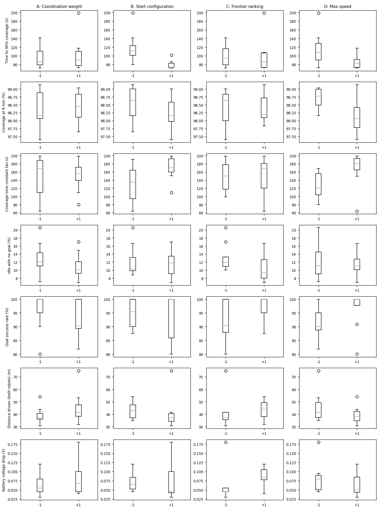

Pearson correlation between responses and covariates (|r| > 0.51 is significant at 0.05 for n = 15):

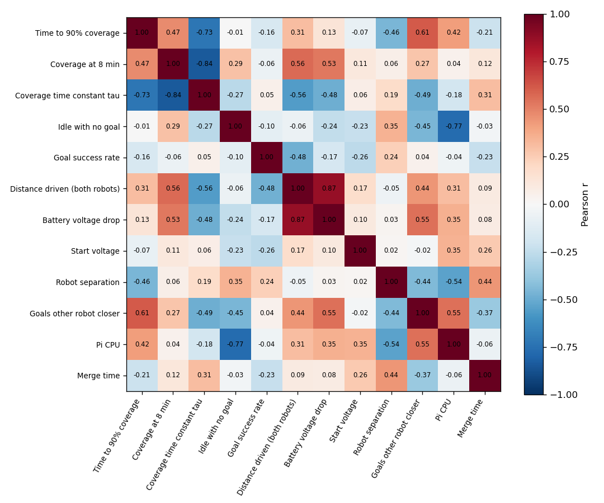

## 2. First look: coordination off vs on (two-sample t-test)

T90 with coordination off: mean 97.1 s (n 7); on: mean 103.7 s (n 8). Pooled two-sample t = -0.36, p = 0.723. This ignores the other factors; the factorial analysis below separates them.

## 3-6. Effects, significance, models and residuals

### Time to 90% coverage (s)

Average 98.88 s. Pooled variance Sp² = 825.8 (7 dof), S_effect = 14.8, t critical = 2.365.

| Effect | E | t | Significant |
| --- | --- | --- | --- |
| A | 9.71 | 0.65 |  |
| B | -40.36 | -2.72 | yes |
| C | -0.59 | -0.04 |  |
| D | -24.51 | -1.65 |  |
| AB=CD | -3.81 | -0.26 |  |
| AC=BD | 19.11 | 1.29 |  |
| AD=BC | -11.51 | -0.78 |  |

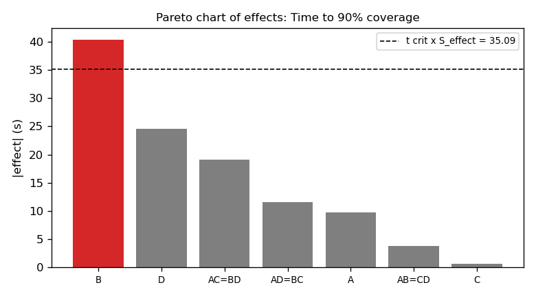

Model (coded units, significant effects only): ŷ = 98.88 -20.18·B

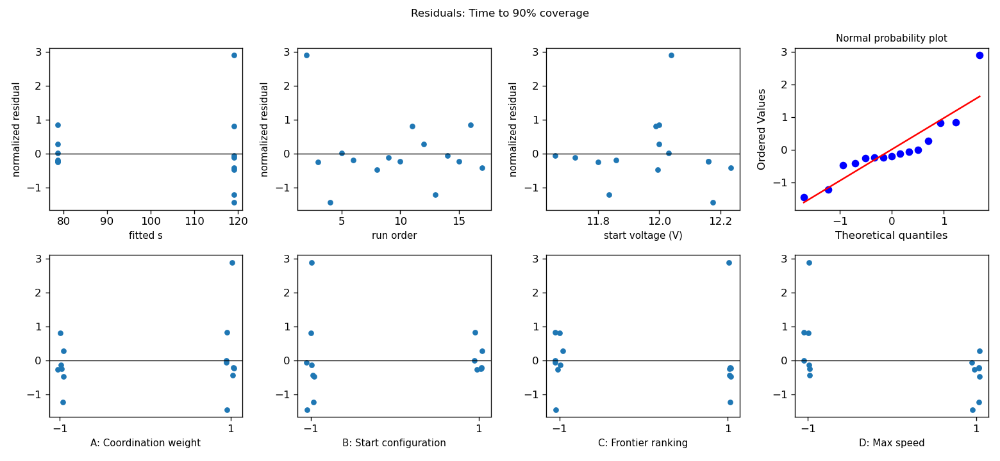

Residual SD 27.477 s. Shapiro-Wilk p = 0.011 (below 0.05 would mean the residuals are not normal). Normalized residuals beyond ±2: R02.

Residuals vs start voltage: slope 1.55 s/V, r = 0.01, p = 0.973.
 No sign that battery level biased this response.

### Coverage at 8 min (%)

Average 98.38 %. Pooled variance Sp² = 0.2566 (7 dof), S_effect = 0.262, t critical = 2.365.

| Effect | E | t | Significant |
| --- | --- | --- | --- |
| A | 0.08 | 0.30 |  |
| B | -0.31 | -1.19 |  |
| C | -0.03 | -0.13 |  |
| D | -0.51 | -1.94 |  |
| AB=CD | 0.46 | 1.77 |  |
| AC=BD | -0.08 | -0.32 |  |
| AD=BC | -0.15 | -0.59 |  |

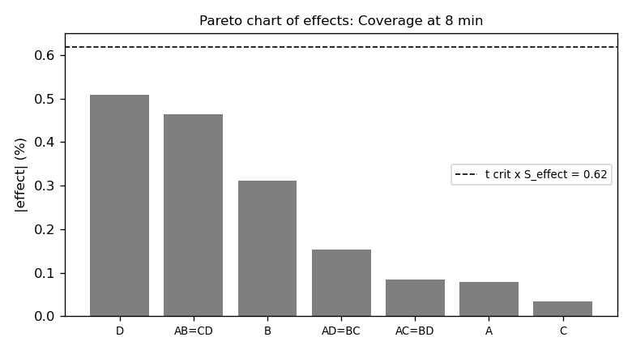

Model (coded units, significant effects only): ŷ = 98.38 

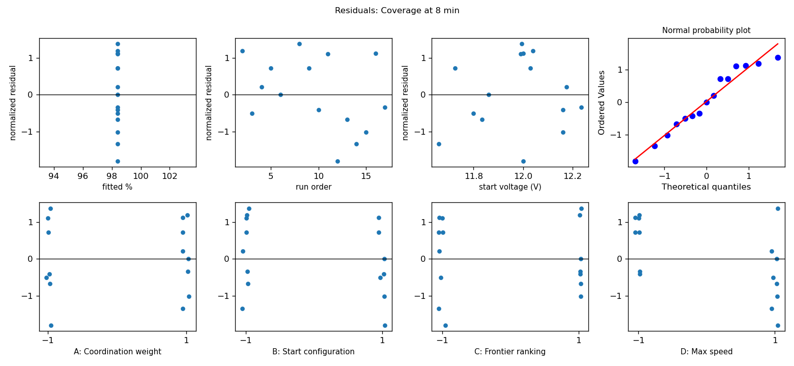

Residual SD 0.546 %. Shapiro-Wilk p = 0.464 (below 0.05 would mean the residuals are not normal). No normalized residual beyond ±2.

Residuals vs start voltage: slope 0.34 %/V, r = 0.11, p = 0.703.
 No sign that battery level biased this response.

### Coverage time constant tau (s)

Average 149.38 s. Pooled variance Sp² = 1883 (7 dof), S_effect = 22.4, t critical = 2.365.

| Effect | E | t | Significant |
| --- | --- | --- | --- |
| A | -0.15 | -0.01 |  |
| B | 38.75 | 1.73 |  |
| C | 1.43 | 0.06 |  |
| D | 34.43 | 1.54 |  |
| AB=CD | -22.80 | -1.02 |  |
| AC=BD | 4.92 | 0.22 |  |
| AD=BC | 13.48 | 0.60 |  |

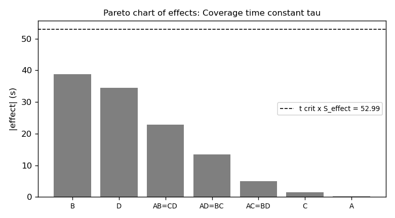

Model (coded units, significant effects only): ŷ = 149.38 

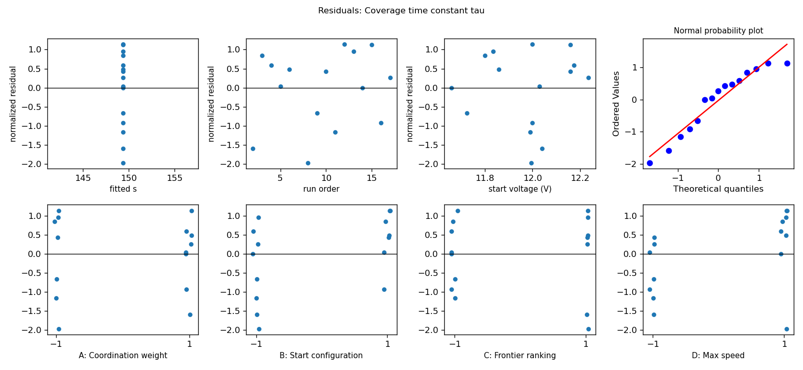

Residual SD 43.482 s. Shapiro-Wilk p = 0.166 (below 0.05 would mean the residuals are not normal). No normalized residual beyond ±2.

Residuals vs start voltage: slope 15.96 s/V, r = 0.06, p = 0.824.
 No sign that battery level biased this response.

### Idle with no goal (%)

Average 11.63 %. Pooled variance Sp² = 15.18 (7 dof), S_effect = 2.01, t critical = 2.365.

| Effect | E | t | Significant |
| --- | --- | --- | --- |
| A | -1.17 | -0.58 |  |
| B | -1.20 | -0.60 |  |
| C | -2.95 | -1.47 |  |
| D | -0.05 | -0.02 |  |
| AB=CD | 4.12 | 2.05 |  |
| AC=BD | 0.83 | 0.42 |  |
| AD=BC | -1.01 | -0.50 |  |

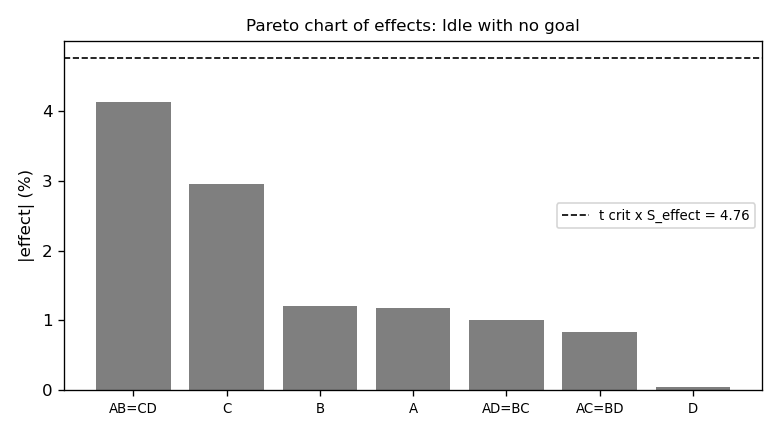

Model (coded units, significant effects only): ŷ = 11.63 

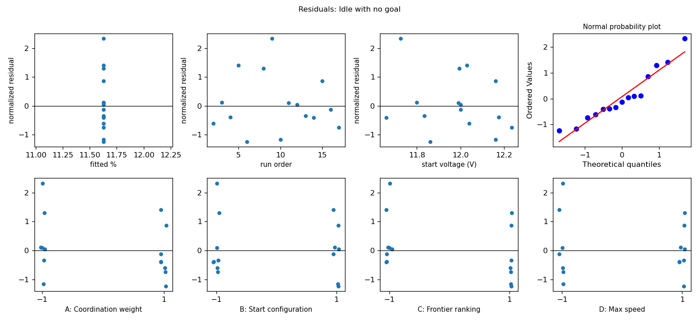

Residual SD 3.836 %. Shapiro-Wilk p = 0.226 (below 0.05 would mean the residuals are not normal). Normalized residuals beyond ±2: R09.

Residuals vs start voltage: slope -5.14 %/V, r = -0.23, p = 0.411.
 No sign that battery level biased this response.

### Goal success rate (%)

Average 94.39 %. Pooled variance Sp² = 46.84 (7 dof), S_effect = 3.53, t critical = 2.365.

| Effect | E | t | Significant |
| --- | --- | --- | --- |
| A | -3.72 | -1.05 |  |
| B | -0.82 | -0.23 |  |
| C | 5.60 | 1.58 |  |
| D | 3.95 | 1.12 |  |
| AB=CD | 1.68 | 0.47 |  |
| AC=BD | -1.90 | -0.54 |  |
| AD=BC | 6.45 | 1.82 |  |

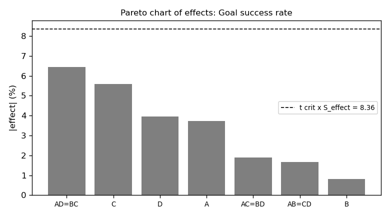

Model (coded units, significant effects only): ŷ = 94.39 

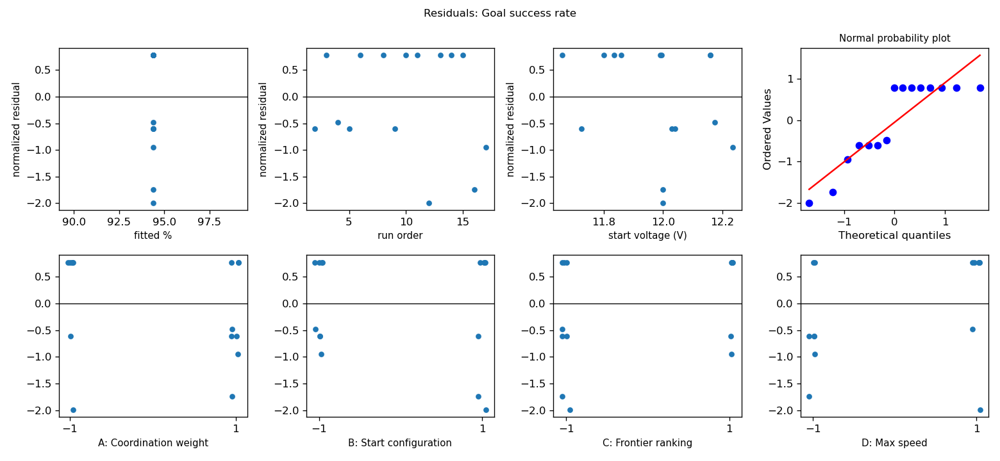

Residual SD 7.232 %. Shapiro-Wilk p = 0.002 (below 0.05 would mean the residuals are not normal). No normalized residual beyond ±2.

Residuals vs start voltage: slope -10.93 %/V, r = -0.26, p = 0.352.
 No sign that battery level biased this response.

### Distance driven (both robots) (m)

Average 42.27 m. Pooled variance Sp² = 100.5 (7 dof), S_effect = 5.18, t critical = 2.365.

| Effect | E | t | Significant |
| --- | --- | --- | --- |
| A | 6.37 | 1.23 |  |
| B | -2.09 | -0.40 |  |
| C | 1.01 | 0.19 |  |
| D | -5.98 | -1.16 |  |
| AB=CD | 5.01 | 0.97 |  |
| AC=BD | -7.01 | -1.35 |  |
| AD=BC | -10.73 | -2.07 |  |

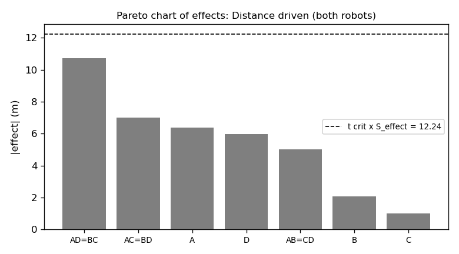

Model (coded units, significant effects only): ŷ = 42.27 

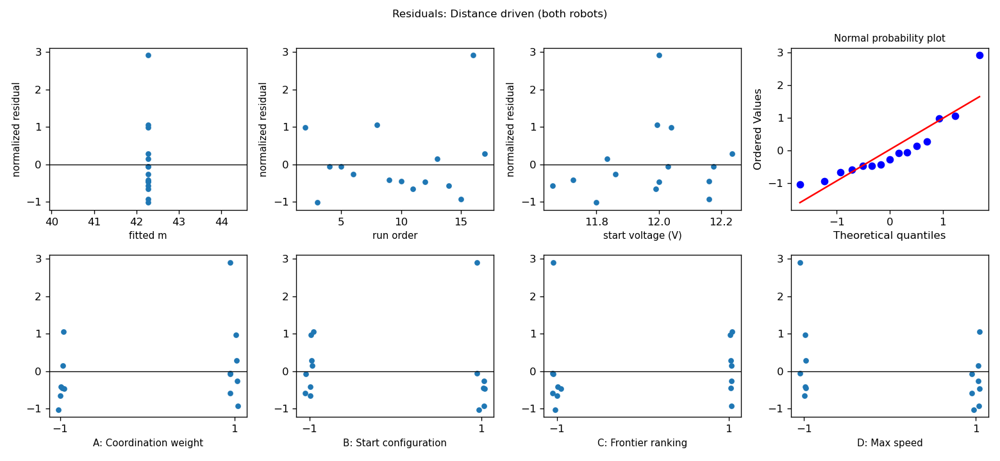

Residual SD 11.210 m. Shapiro-Wilk p = 0.007 (below 0.05 would mean the residuals are not normal). Normalized residuals beyond ±2: R16.

Residuals vs start voltage: slope 11.27 m/V, r = 0.17, p = 0.540.
 No sign that battery level biased this response.

### Battery voltage drop (V)

Average 0.075 V. Pooled variance Sp² = 0.0018946 (7 dof), S_effect = 0.02248, t critical = 2.365.

| Effect | E | t | Significant |
| --- | --- | --- | --- |
| A | 0.014 | 0.64 |  |
| B | 0.007 | 0.31 |  |
| C | 0.024 | 1.08 |  |
| D | -0.018 | -0.81 |  |
| AB=CD | 0.019 | 0.86 |  |
| AC=BD | -0.023 | -1.03 |  |
| AD=BC | -0.018 | -0.81 |  |

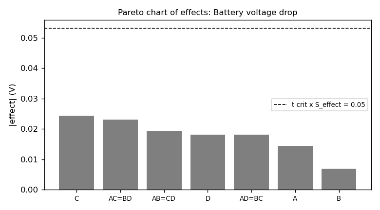

Model (coded units, significant effects only): ŷ = 0.075 

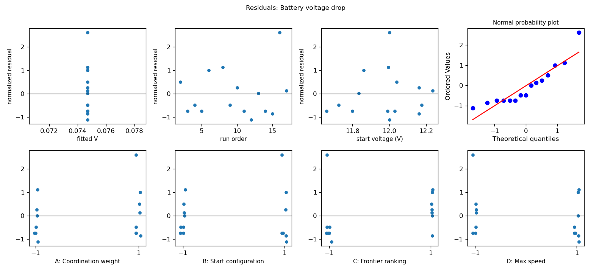

Residual SD 0.040 V. Shapiro-Wilk p = 0.023 (below 0.05 would mean the residuals are not normal). Normalized residuals beyond ±2: R16.

Residuals vs start voltage: slope 0.02 V/V, r = 0.10, p = 0.730.
 No sign that battery level biased this response.

## 7. Session (block) check

Paired t-test of replicate 1 (session 1) against replicate 2 (session 2), paired by condition. A significant difference means something changed between sessions.

| Response | Pairs | Mean diff (1 - 2) | t | p |
| --- | --- | --- | --- | --- |
| Time to 90% coverage | 7 | 1.50 | 0.09 | 0.931 |
| Coverage at 8 min | 7 | 0.52 | 2.60 | 0.041 |
| Coverage time constant tau | 7 | -22.69 | -0.97 | 0.367 |
| Idle with no goal | 7 | 1.93 | 0.92 | 0.395 |
| Goal success rate | 7 | 1.66 | 0.43 | 0.685 |
| Distance driven (both robots) | 7 | -0.83 | -0.14 | 0.891 |
| Battery voltage drop | 7 | 0.01 | 0.20 | 0.848 |

## 8. Coverage curves

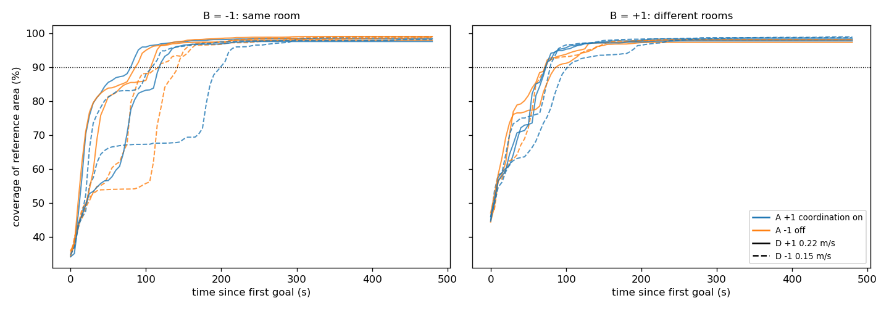

Linearized fit ln(1 − A) = t_d/τ − t/τ: R² median 0.662 (range 0.572–0.920). τ is analyzed as a response in section 3.

## 9. Curvature check with centre points

Two-sample t-test of centre-point runs against the factorial runs. A significant difference means the response curves between the levels, so the best setting may lie between them (fit a quadratic in that factor).

| Response | Centre mean | Factorial mean | t | p | Curvature |
| --- | --- | --- | --- | --- | --- |
| Time to 90% coverage | 78.30 | 100.65 | -0.89 | 0.388 |  |
| Coverage at 8 min | 97.66 | 98.40 | -1.84 | 0.086 |  |
| Coverage time constant tau | 201.70 | 148.13 | 1.69 | 0.111 |  |
| Idle with no goal | 12.42 | 11.92 | 0.16 | 0.876 |  |
| Goal success rate | 100.00 | 94.02 | 1.14 | 0.273 |  |
| Distance driven (both robots) | 38.83 | 42.61 | -0.46 | 0.649 |  |
| Battery voltage drop | 0.07 | 0.07 | -0.22 | 0.828 |  |

## 10. Optimization

Minimize predicted T90 over coded A, C, D in [-1, +1], for each start configuration B, subject to predicted goal success ≥ 90% and predicted battery drop ≤ 0.15 V. Each model keeps only its significant effects; a response with no significant effect is its average everywhere.

| B | A | C | D | Settings (coord, pot:gain, speed) | Predicted T90 (s, 95% PI) | Pred. success % | Pred. drop V |
| --- | --- | --- | --- | --- | --- | --- | --- |
| -1 | -0.90 | -0.90 | -0.90 | 0.05, 1.95:1.05, 0.153 m/s | 119.1 ± 72.3 | 94.4 | 0.075 |
| 1 | -0.90 | -0.90 | -0.90 | 0.05, 1.95:1.05, 0.153 m/s | 78.7 ± 72.3 | 94.4 | 0.075 |

Best overall: B = +1 (different_rooms), predicted T90 78.7 s. Two-level models put the optimum at a corner of the region unless a constraint binds; a centre-point curvature result in section 9 would call for a quadratic term before trusting an interior optimum.

Sensitivity of the optimum to the limits (same B):

| Success ≥ | Drop ≤ | Predicted T90 (s) | A, C, D |
| --- | --- | --- | --- |
| 85% | 0.15 V | 78.7 | -0.90, -0.90, -0.90 |
| 95% | 0.15 V | infeasible |  |
| 90% | 0.12 V | 78.7 | -0.90, -0.90, -0.90 |
| 90% | 0.18 V | 78.7 | -0.90, -0.90, -0.90 |

Add confirmation runs for this setting with:

```bash
python3 entc641/plan.py add-confirm --best -0.9 1 -0.9 -0.9
```

## 11. Confirmation runs

No complete confirmation pairs yet.

